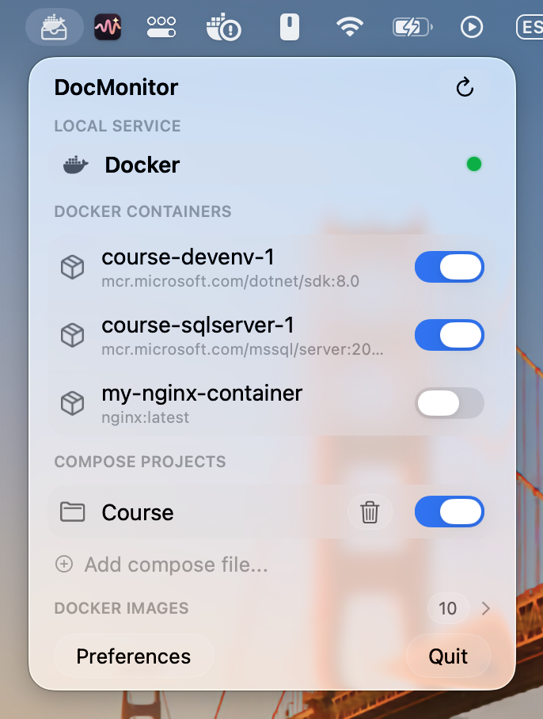

<p align="center">
  
</p>

<h1 align="center">DocMonitor</h1>

<p align="center">English · <a href="README.es.md">Español</a></p>

<p align="center">
  A native macOS menu bar app to manage the images, containers and Compose projects of Docker.
</p>

<p align="center"></p>

## Features

- **Containers:** list, start, stop and delete.
- **Console:** open a terminal inside a container from the menu bar.
- **Images:** list, pull, delete and build from a Dockerfile.
- **Container creation:** create a container straight from an image.
- **Docker Compose:** `up` and `down` projects, and add projects manually.
- **Native:** built with Swift and SwiftUI, with the macOS 26 Liquid Glass design. It talks to Docker directly through its Unix socket, so there is no Electron and no extra runtime.

## Requirements

- macOS 26 (Tahoe) or later.
- A running Docker engine reachable at `/var/run/docker.sock` (for example, Docker Desktop).

## Installation

DocMonitor is source-available and distributed **without Apple notarization** (see [Why isn't it notarized?](#why-isnt-it-notarized)). That means macOS will warn you the first time you open it. This is expected, and it only has to be done once.

1. Download `DocMonitor-x.y.z.zip` from the [latest release](https://github.com/cessadev/docmonitor/releases/latest).
2. *(Optional)* Verify the download against the SHA-256 published in the release notes:
   ```bash
   shasum -a 256 DocMonitor-x.y.z.zip
   ```
3. Unzip it and move `DocMonitor.app` to your `Applications` folder.
4. Open it. macOS will say it could not verify the app. Click **Done** (not "Move to Trash").
5. Open **System Settings → Privacy & Security**, scroll to the **Security** section and click **Open Anyway** next to the DocMonitor message. Confirm with your password or Touch ID, then click **Open**.

If you prefer the terminal, you can instead remove the quarantine flag that macOS adds to downloaded files:

```bash
xattr -dr com.apple.quarantine /Applications/DocMonitor.app
```

> On macOS 15 and later the old "right-click → Open" shortcut no longer bypasses this warning, so use one of the two methods above.

### Permissions

The first time you open a console in a container, macOS asks whether DocMonitor may control Terminal. Click **Allow**. If you denied it by mistake, re-enable it in **System Settings → Privacy & Security → Automation**.

Because the app is signed ad hoc (see below), macOS treats every new version as a different app and may ask for this permission again after an update. To reset it manually:

```bash
tccutil reset AppleEvents com.cessadev.DocMonitor
```

## Build from source

You need Xcode 26 or later.

```bash
git clone https://github.com/cessadev/docmonitor.git
cd docmonitor
open DocMonitor.xcodeproj
```

Then press **Run** (⌘R).

To produce a release build from the command line:

```bash
xcodebuild -project DocMonitor.xcodeproj -scheme DocMonitor \
  -configuration Release -derivedDataPath build \
  CODE_SIGN_IDENTITY="-" CODE_SIGNING_REQUIRED=NO
```

The app is created at `build/Build/Products/Release/DocMonitor.app`. Building from source on your own Mac also avoids the Gatekeeper warning, since locally built apps are not quarantined.

## Why isn't it notarized?

Notarization requires a paid Apple Developer Program membership. DocMonitor is a free, source-available project, so releases are signed with an *ad-hoc* signature instead. That signature does not identify a developer, but it does guarantee that the code has not been modified since it was built. If you would rather not trust a pre-built binary, build it yourself from source as shown above.

## Contributing

Bug reports and suggestions are welcome as issues. If you want to contribute code, open an issue first so we can agree on it.

## License

DocMonitor is licensed under the [PolyForm Strict License 1.0.0](LICENSE). You may use it for noncommercial purposes. Distributing it, modifying it or using it commercially requires the author's permission.
